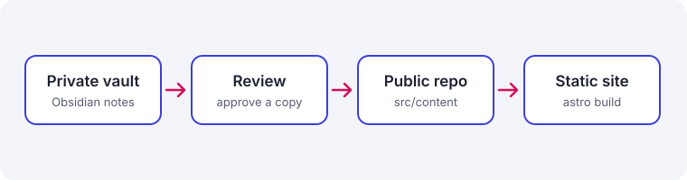

This site is the public face of **Personal OS**. Every post originates in a private Obsidian vault; only a reviewed and approved copy is placed in this repository and built into static pages.

## Three things separated from the start

- **Time** — dates are stored as ISO 8601 and formatted only at render time, for the reader's locale and time zone.
- **Language** — Korean is the default (`/`), English lives under `/en/`. Translations share a `translationKey` and are linked with `hreflang`.
- **Exposure** — `visibility` (private / restricted / public) and `draft` are independent axes. Lists show public posts only, restricted posts are reachable by link, and private ones are never built.

```ts
// src/utils/date.ts
new Intl.DateTimeFormat(locale, { dateStyle: 'medium', timeZone }).format(date);
```

## Plain Markdown in, designed pages out

The source stays ordinary Markdown. It keeps the syntax I already use in [Obsidian](https://obsidian.md), and the [Astro](https://astro.build) build turns it into figures, callouts, code cards and heading links.



To preview locally, start `npm run dev` and stop it with <kbd>Ctrl</kbd> + <kbd>C</kbd>.

Future posts cover only what I have done and measured myself.

> [!NOTE]
> Public posts default to CC BY 4.0; each post can override it with `license` in its frontmatter.
