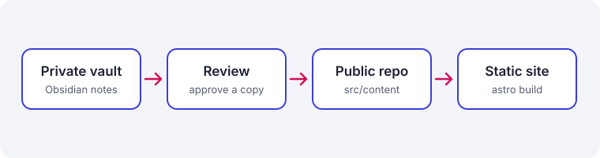

이 사이트는 **Personal OS**의 공개 면입니다. 글의 원본은 비공개 Obsidian Vault에 있고, 검토와 승인을 거친 사본만 이 저장소로 복사되어 정적 사이트로 빌드됩니다.

## 처음부터 분리해 둔 세 가지

- **시간** — 날짜는 ISO 8601로 저장하고, 화면에 보일 때만 독자의 locale과 시간대에 맞춰 포맷합니다.
- **언어** — 한국어가 기본(`/`)이고 영어는 `/en/`입니다. 같은 글의 번역본은 `translationKey`로 묶여 `hreflang`으로 연결됩니다.
- **노출성** — `visibility`(private / restricted / public)와 `draft`는 별개의 축입니다. 목록에는 public만 보이고, restricted는 링크를 아는 사람만 볼 수 있으며, private는 아예 빌드되지 않습니다.

```ts
// src/utils/date.ts
new Intl.DateTimeFormat(locale, { dateStyle: 'medium', timeZone }).format(date);
```

## Markdown은 그대로, 화면은 빌드가

원본은 평범한 Markdown입니다. [Obsidian](https://obsidian.md)에서 쓰던 문법 그대로 두고, [Astro](https://astro.build) 빌드가 그림·콜아웃·코드 카드·제목 링크로 바꿉니다.



로컬에서 미리 볼 때는 `npm run dev`로 띄우고 <kbd>Ctrl</kbd> + <kbd>C</kbd>로 끕니다.

앞으로 올라올 글은 직접 겪고 측정한 것만 다룹니다.

> [!NOTE]
> 공개 글의 기본 라이선스는 CC BY 4.0입니다. 글마다 frontmatter의 `license`로 바꿀 수 있습니다.
